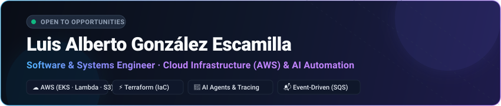

 

 

### 🚀 Systems & Software Engineer · Cloud Infrastructure & AI Automation
*Architecting resilient cloud systems on AWS, decoupled event-driven workflows, and production AI agent platforms.*

---

### 👨‍💻 Executive Summary

I am a software and systems engineer specialized in **cloud infrastructure (AWS)**, **container orchestration (Kubernetes / EKS)**, and **production AI agent workflows**.

* **Production Reliability:** Owned the end-to-end reliability of conversational AI phone and chat agents processing **10,000+ executions per month** at TendencIA Systems.
* **Distributed Observability:** Integrated **Langfuse** distributed tracing and automated **Vitest** test suites to drastically slash incident MTTR across live production systems.
* **FinOps & Governance:** Engineered serverless data ingestion pipelines turning high-frequency webhook events into automated per-client cost and usage telemetry.
* **Infrastructure as Code (IaC):** Automated cloud infrastructure provisioning on AWS (S3, SES, Location Service, IAM) with **Terraform** following least-privilege security principles.

---

### 📊 Production Track Record & Metrics

| Metric | Focus Area | Engineering Implementation & Impact |
| :---: | :--- | :--- |
| **10,000+** | **Monthly AI Invocations** | Maintained production voice & chat agents connecting telephony (Vapi, Twilio) to CRMs with zero message dropouts. |
| **12+** | **Critical Incidents Resolved** | Diagnosed and shipped fixes for multi-service production incidents using Langfuse tracing and health telemetry. |
| **100%** | **Infrastructure as Code** | Automated cloud provisioning across AWS resources (S3, SES, IAM, Location Service) via declarative **Terraform** modules. |
| **Zero-Drop** | **Event Decoupling** | Architected asynchronous queue buffering with **Amazon SQS** & **EC2 worker daemons** to absorb sudden concurrency bursts. |

---

### 🛠️ Tech Stack & Core Competencies

#### Cloud Infrastructure & DevOps

#### AI, Agents & Observability

#### Languages, Backend & Databases

---

### 🌟 Featured Systems & Cloud Architectures

<table>
  <tr>
    <td width="50%" valign="top">
      <h3>🏡 <a href="https://github.com/LinguiniPanini/ReparaYa">ReparaYa — Marketplace (Terraform IaC)</a></h3>
      
Production full-stack on-demand home services platform with automated cloud infrastructure on AWS provisioned via <b>Terraform</b>.

      <ul>
        <li><b>Infrastructure as Code:</b> Terraform modules managing <b>Amazon S3</b> (media), <b>Amazon SES</b> (emails), <b>Amazon Location Service</b> (geocoding), and least-privilege <b>IAM</b> policies.</li>
        <li><b>Application Stack:</b> Modular monolith built with <b>Next.js 14 (App Router)</b>, TypeScript, Prisma ORM, PostgreSQL, and Stripe Connect.</li>
        <li><b>DevOps:</b> Continuous integration and automated validation on GitHub Actions.</li>
      </ul>
      

        
      

    </td>
    <td width="50%" valign="top">
      <h3>🧠 <a href="https://github.com/LinguiniPanini/MLemons">MLemons — MLOps Pipeline on AWS</a></h3>
      
End-to-end computer vision machine learning pipeline orchestrated on AWS with <b>Terraform</b>.

      <ul>
        <li><b>Inference:</b> Deep learning MobileNetV2 transfer learning deployed to an <b>AWS SageMaker Endpoint</b>.</li>
        <li><b>Orchestration:</b> Multi-step execution via <b>AWS Step Functions</b> and <b>Lambda</b> storing metadata in <b>DynamoDB</b> and artifacts in <b>S3</b>.</li>
        <li><b>IaC:</b> Full infrastructure codified with Terraform including CloudWatch alarms and IAM execution roles.</li>
      </ul>
      

        
      

    </td>
  </tr>
  <tr>
    <td width="50%" valign="top">
      <h3>🚀 <a href="https://github.com/LinguiniPanini/aws-eks-microservices-platform">AWS EKS Microservices Platform</a></h3>
      
Distributed invoicing and sales platform running across 4 decoupled microservices inside an <b>Amazon EKS (Kubernetes)</b> cluster.

      <ul>
        <li><b>Services:</b> REST API, PDF Generator, Notifier, and long-polling Receipt Worker.</li>
        <li><b>Messaging & Storage:</b> Decoupled via <b>Amazon SQS</b>, invoice archival in <b>Amazon S3</b>, alerts via <b>Amazon SNS</b>, and persistence with <b>Amazon RDS PostgreSQL</b>.</li>
        <li><b>Orchestration:</b> Declarative Kubernetes manifests, ConfigMaps, Secrets, and LoadBalancer services.</li>
      </ul>
      

        
      

    </td>
    <td width="50%" valign="top">
      <h3>⚡ <a href="https://github.com/LinguiniPanini/aws-serverless-order-pipeline">AWS Serverless Order Pipeline</a></h3>
      
Event-driven serverless architecture orchestrated with <b>AWS Step Functions</b> for high-throughput sales processing.

      <ul>
        <li><b>Compute:</b> Stateful state machine orchestrating 8 <b>AWS Lambda</b> microservices with shared custom Lambda Layers.</li>
        <li><b>Integration:</b> Ingestion buffered via <b>Amazon SQS</b>, receipts stored in <b>Amazon S3</b> with custom metadata, and transactional emails via <b>Amazon SES</b>.</li>
        <li><b>Automation:</b> 100% automated cloud provisioning script with AWS CLI and Amazon API Gateway.</li>
      </ul>
      

        
      

    </td>
  </tr>
  <tr>
    <td width="50%" valign="top">
      <h3>📬 <a href="https://github.com/LinguiniPanini/aws-sqs-event-processor">AWS SQS Event-Driven Processor</a></h3>
      
Asynchronous queue buffering system engineered to decouple burst traffic from relational database writes.

      <ul>
        <li><b>Queue Decoupling:</b> <b>Amazon SQS</b> with long-polling (20s) and visibility timeout rollback handling.</li>
        <li><b>Compute & DB:</b> Daemon running on an <b>Amazon EC2</b> instance persisting transactions to <b>Amazon RDS PostgreSQL</b>.</li>
        <li><b>Security:</b> EC2 instance profile assuming strict least-privilege IAM policies. Includes architectural diagram & video walkthrough.</li>
      </ul>
      

        
        
      

    </td>
    <td width="50%" valign="top">
      <h3>🔄 <a href="https://github.com/LinguiniPanini/k8s-cicd-pipeline">Kubernetes GitOps CI/CD Pipeline</a></h3>
      
Continuous integration and delivery pipeline automating multi-stage testing, container builds, and Kubernetes rollouts.

      <ul>
        <li><b>CI Stage:</b> Pull request test validation with automated gates.</li>
        <li><b>CD Stage:</b> Multi-architecture Docker builds published to Docker Hub upon semver git tagging (`v*`).</li>
        <li><b>Deploy Stage:</b> Zero-downtime rolling update deployment to a Kubernetes cluster applying declarative manifests.</li>
      </ul>
      

        
      

    </td>
  </tr>
</table>

---

### 🤝 Let's Connect
Feel free to reach out for engineering opportunities, cloud architecture discussions, or collaboration on distributed AI systems.

